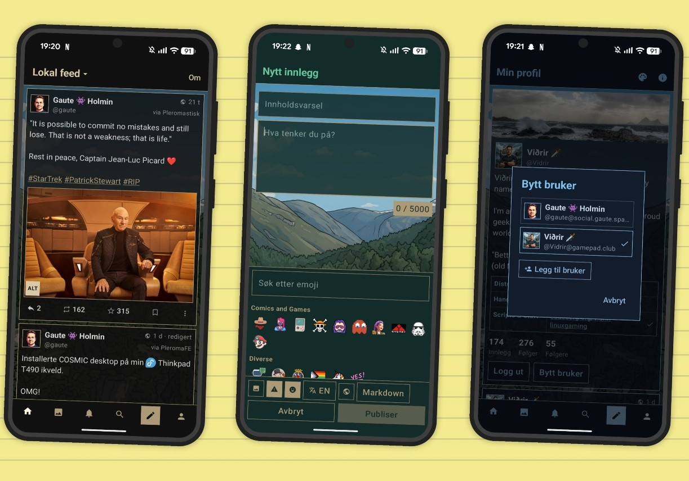

# Feditastic

Dette er en Android-klient for Fediverset. Den virker mot plattformer som for eksempel Pleroma Social,
Akkoma, GoToSocial og Mastodon. Appen har norsk og engelsk grensesnitt.

## Skjermbilder

Her er noen skjermbilder som eksempler på hvordan appen ser ut. Den finnes per nå kun for Android.



## Funksjoner

**Lese**
- Innlogging med OAuth på instansens egen side – passordet går aldri via appen.
- Flere brukere, også på ulike instanser. Bytt med «Bytt bruker» på profilsiden.
- Tidslinjer: Hjem, lokal feed, fødererte innlegg og egne lister (velg i «Hjem ▾»).
- Tråder, profiler med profilfelt og bekreftede lenker, og følg/slutt å følge.
- Lenkeforhåndsvisning, antall svar/delinger/favoritter og «via <app>».
- Egendefinerte emojier fra instansen, avstemninger og varsler med filter for **Alle** eller **Svar**.
- Søk etter brukere (`@navn@domene`) og emneknagger. Trykk på #emneknagger og @omtaler for å åpne dem i appen.

**Skrive og samhandle**
- Svar, del, favoritt, bokmerke, kopier lenke og slett eller rediger egne innlegg.
- Synlighet, innholdsvarsel, opptil 4 bilder med alt-tekst, Markdown, emoji-velger og språkvalg (nn, nb, en).
- Tegngrensen hentes fra instansen (5000 hvis den ikke oppgir noe).
- Legg brukere til i lister fra profilen deres.

**Bilder og video**
- Bilder vises uten beskjæring. Trykk for fullskjerm med alt-tekst, zoom og sveip mellom bilder.
- Video vises med forhåndsbilde og spilles av i en annen app.
- Fanen «Bilder» viser de samme feedene som «Hjem», men bare innlegg med bilder eller video – med
  bildet først og teksten under, som i Pixelfed og Instagram. Flere bilder blas sidelengs.

**Navigasjon**
- Bunnmeny: Hjem · Bilder · Varsler · Søk · Skriv · Profil. Hold inne en knapp for å skjule tekstene.
- Sveip mellom fanene. Dobbelttrykk på en fane for å oppdatere, eller på toppfeltet for å rulle til toppen.

**Chat og annet**
- Chat-ikonet på «Hjem» åpner «Matrix»: [chat.gaute.space](https://chat.gaute.space) i appen – Matrix-klienten
  [Cinny](https://cinny.in) med appens farger. Forbindelsen holdes i live når du bytter faner.
- «Om»-knappen i lokal feed viser instansens «Om»-side og tjenestevilkår.
- Fem fargetemaer i samme stil – Mørk (standard), Grønn, Blå, Lilla og Lys – velges med palett-knappen på «Profil».
- ⓘ på «Profil» viser informasjon om appen og lenke til kildekoden.

### Ikke med (ennå)

Søk i innleggstekst, Pleroma-chat, å sende emoji-reaksjoner, push-varsler, sanntidsstrøm, redigering av profil
og avspilling av video i appen (åpnes i en annen app).

## Installere

1. Last ned `Feditastic.apk` fra siden for utgivelser i dette repoet.
2. Tillat installasjon fra ukjente kilder for appen du åpner filen med.
3. Åpne **Feditastic**, skriv inn instansen (f.eks. `social.gaute.space`) og trykk
   **Logg inn**. Godkjenn appen i nettleseren – du sendes automatisk tilbake til appen.

Krever Android 8.0 (API 26) eller nyere.

## Bygge selv

Du trenger JDK 17 eller nyere og Android SDK (plattform 35). Enklest er å åpne mappen i
Android Studio. Fra kommandolinjen:

```bash
echo "sdk.dir=/sti/til/Android/Sdk" > local.properties
./gradlew assembleDebug
# APK: app/build/outputs/apk/debug/app-debug.apk
```

`./gradlew assembleRelease` gir den lille, optimaliserte APK-en (ca. 2 MB, ikke «debuggable»).
Den er signert med debug-nøkkelen slik at den kan installeres rett på mobilen. Bytt til din
egen signeringsnøkkel i `app/build.gradle.kts` før du publiserer i en app-butikk. Vil du
oppdatere en eksisterende installasjon, må ny APK være signert med samme nøkkel som den
gamle, ellers må du avinstallere først.

## Teknisk

| | |
|---|---|
| Språk / UI | Kotlin, Jetpack Compose (Material 3 med eget tema) |
| Nettverk | OkHttp + kotlinx.serialization |
| Bilder | Coil |
| Navigasjon | Navigation Compose |
| Chat | Android WebView med [Cinny](https://cinny.in) fra chat.gaute.space |
| API | Mastodon-kompatibelt API (`/api/v1/...`) som Pleroma implementerer |
| Redirect-skjema | `pleromastisk://oauth` |
| OAuth-scopes | `read write follow push` |
| Pakkenavn | `app.pleromastisk` |

Kildekoden ligger i `app/src/main/java/app/pleromastisk/`:

- `data/` – datamodeller, API-klient og lagring av innlogging
- `vm/` – ViewModels (tidslinjer, tråd, profil, varsler, lister, innlogging)
- `ui/` – skjermer, tema (`Theme.kt` har fargene fra Pleroma-temaet) og komponenter

## Personvern

Appen har ingen sporing eller analyse. Den snakker bare med instansen du velger, og henter
bilder og emojier fra adressene instansen oppgir. Tilgangstoken lagres kun lokalt på
enheten, og «Logg ut» sletter det for brukeren du er logget inn som.

Åpner du chatten, lastes Cinny fra chat.gaute.space, og den snakker med Matrix-tjeneren du
logger inn på der (som standard norge.chat). Innloggingen i chatten lagres i appens egen
nettleserlagring på enheten og er uavhengig av Pleroma-innloggingen.

## Lisens

Copyright © 2026 Gaute Holmin

Feditastic er fri programvare, lisensiert under
[**GNU General Public License versjon 3 eller senere (GPL-3.0-or-later)**](https://www.gnu.org/licenses/gpl-3.0.html).
Fullstendig tekst ligger i [`LICENSE`](LICENSE).

I praksis betyr det:

- ✅ Du kan bruke, kopiere, endre og dele appen og koden, også kommersielt.
- ✅ Deler du appen eller en endret versjon av den, må du gjøre **kildekoden tilgjengelig
  under samme lisens** (GPL-3.0-or-later), og beholde opphavsrettsmerknadene.
- ❌ Du kan **ikke** lage en lukket versjon av appen eller koden og distribuere den.

Programmet leveres **uten noen form for garanti**, se avsnitt 15 og 16 i lisensen.

**Bakgrunnsbildet** (`app/src/main/res/drawable-nodpi/bakgrunn.jpg`) er tatt av
Gaute Holmin og er lisensiert under den samme lisensen som resten av appen (GPL-3.0-or-later).

**Chatten** er [Cinny](https://cinny.in) ([kildekode](https://github.com/cinnyapp/cinny)),
en Matrix-klient laget av Ajay Bura og bidragsyterne til Cinny-prosjektet, lisensiert under
AGPL-3.0. Cinny er ikke en del av appen: den kjører på chat.gaute.space og vises i appen,
som legger på egne farger.

Tredjepartsbiblioteker (Jetpack Compose, OkHttp, Coil, kotlinx.serialization m.fl.) er
Apache-2.0-lisensiert og følger sine egne vilkår.
